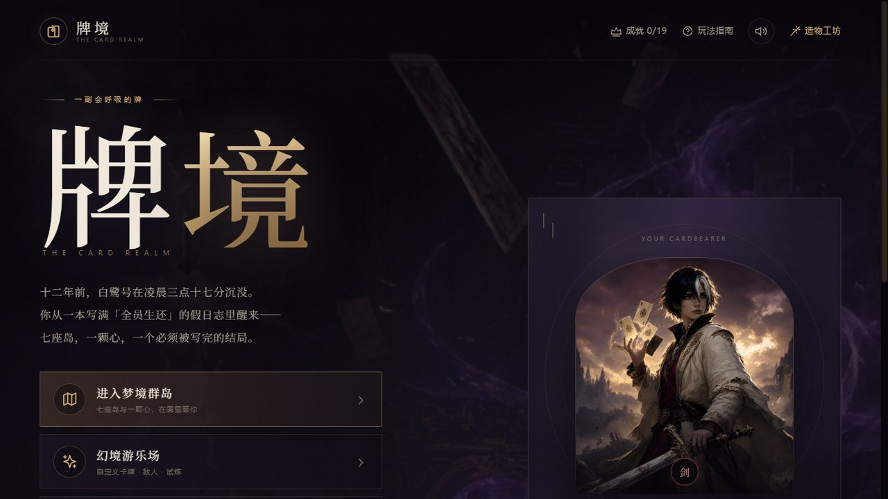
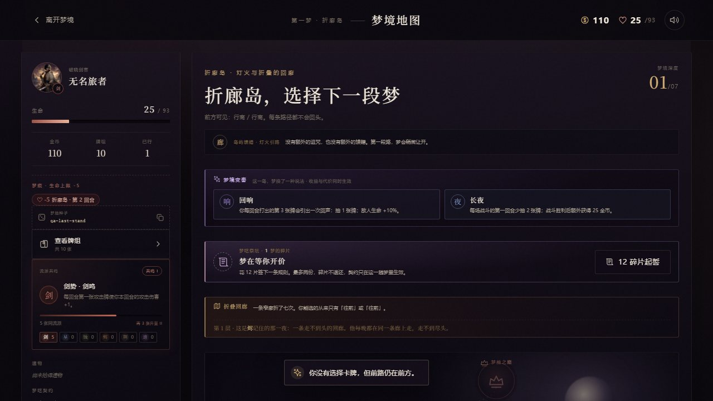
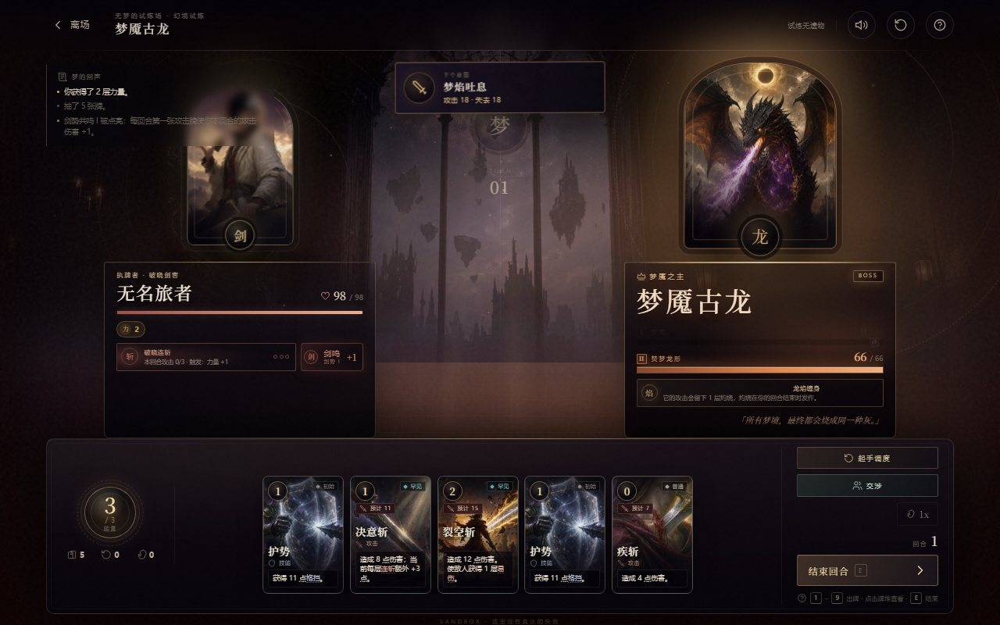
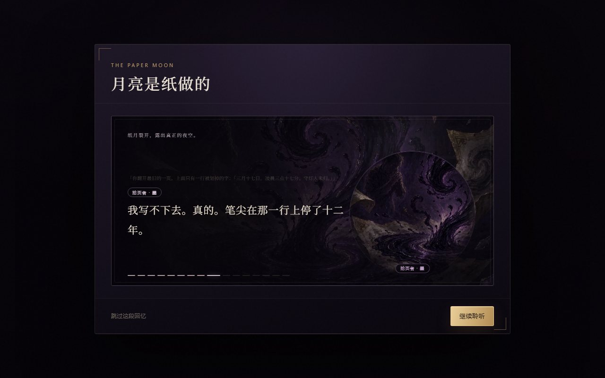

# 牌境 · The Card Realm

十二年前，白鹭号在凌晨三点十七分沉没。你从一本写满「全员生还」的假日志里醒来，手里只剩一副牌。

卡牌肉鸽，舞台是八座靠航路连起来的梦岛。单机为主，也能两个人联机。Windows 桌面版和网页版是同一份代码。

当前版本：**v2.1.6**



## 为什么做这个

我玩这类游戏最烦两件事。

一是后期难度靠给首领加血。数字变大，回合变长，但你要做的决定还是那几个。所以这里二阶段的首领改的是规则：镜潮之主记住你打出的每一点伤害再反震回来，焚名圣者直接禁止一切治疗，剪月皇后每回合从弃牌堆里剪掉你的牌，二阶段剪两张。

二是剧情在很多构筑游戏里只是开场的过场。这里 25 段剧情配了 46 张场景和 19 件道具，没有一张图跨故事复用。写到哪一段，画面就换到哪一段。

## 一局大概是这样

从折廊岛开始。地图不是一条从左到右的线，是一张能来回走的航路图。清掉一座岛，跟它相邻的航路才会从雾里浮出来——开局只有折廊，踏平之后雾隐、骨庭、镜潮、潮钟四条路同时亮起；心岛要灰烬、潮钟、纸月三支齐通才开。走一半可以收帆回港，牌和金币留着，但这座岛不算清。

路上会遇上 11 位 NPC，分同行者、中立、敌对三拨，每人四层对白。你可以跟他们换牌、给钱、或者干脆动手。与灵智之敌交涉会留下记忆，有些记忆要到很后面才用得上。



## 里面有什么

| | |
|---|---|
| 起源 | 5 个，资源骨架各不相同：破晓 3 能量、星陨 4 能量、暮影 4 能量、烬誓者能烧血换能量、奶蛙蛙靠 0 费续牌 |
| 卡牌 | 145 张，每张都有独立卡面 |
| 流派 | 6 个；纯流派共鸣和混搭「混响」是两条互斥路线 |
| 首领 | 8 位，二阶段会改规则，不靠加血 |
| 剧情 | 25 段、6 种结局（含 2 种隐藏）、11 位 NPC |
| 长线 | 11 层梦境阶梯、21 项成就、每日梦魇、梦境变奏、梦呓契约 |
| 联机 | 镜像决斗（PvP）与共梦之战（双人合作） |

几个我觉得值得一提的设计：

**两条构筑路线是真的互斥。** 纯流派按 4 / 8 / 12 张和 40% / 50% / 60% 占比分三级共鸣，下限高、成型稳。混响要求至少 3 个流派各 ≥2 张、且没有流派占到 65%，前期更脆、吃排序，但 22 张成型牌组实测反超纯流派约 14 个百分点。两条路不会同时白送。

**首领有两条血条。** 第一条打空先假死见底，留下划穿数字的「碎」痕，立绘做一次 3D 翻牌换成真形，第二条才展开。翻开之前第二条完全不占版面，不剧透。这只是显示上的分池，引擎里仍是同一条生命。

**每趟远征抽两条变奏。** 燃梦、长夜、回响、凝滞、薄暮、余温、空梦、逆鳞、贪梦，每条都同时给收益和代价：回响让每回合第 3 张牌抽 1 张，但敌人生命 +10%；逆鳞让首领真形提前 10% 降临，但打赢多给 60 金币。同种子同岛永远抽同样两条，方便复盘。





## 直接开玩

Windows 10 / 11 64 位。到 [Releases](releases) 下载 `CardRealm-win-x64.zip`，解压后双击 `CardRealm.exe`。

- 不要只复制 exe，同目录的 `wwwroot` 是游戏资源，缺了起不来。
- 程序自带 .NET 运行时，但需要 **WebView2 Runtime**。Win11 和多数 Win10 已经自带，缺的话去[微软官网](https://developer.microsoft.com/microsoft-edge/webview2/)装 Evergreen Runtime。
- `F11` 全屏。

## 网页版

同一份代码可以直接静态托管，没有任何构建步骤：

```bash
python -m http.server 4173
# 打开 http://127.0.0.1:4173
```

要联机的话，另开一个终端跑中继：

```bash
python server/server.py
```

网页版会自动把联机地址设成同域 `/ws`，玩家不用手填服务器。打包成可部署目录：

```bash
bash tools/build-web.sh
# 产物：dist/web/site 与 CardRealm-web.tar.gz
```

`CardRealm-web.tar.gz` 里带了 Nginx 配置和 `install.sh`，细节见 [docs/online-server.md](docs/online-server.md)。

## 操作

鼠标为主。战斗里 `1`–`9` 直接打手上对应位置的牌，`E` 结束回合，`Esc` 返回上一层。

## 目录

```text
index.html, css/, js/     游戏本体，零构建 ES Modules
assets/                   卡面、立绘、场景、音效
server/server.py          联机中继（Python + websockets）
server/                   中继的 systemd 与 Nginx 样例
desktop/                  WinForms + WebView2 桌面壳
tools/                    卡面清单、裁切去水印、打包与 QA 脚本
docs/                     平衡记录、联机部署、设计调研
```

## 开发

游戏本身没有 npm、没有打包器，改完刷新就行。QA 和构建脚本用 Node 与 Python：

```bash
# 剧情画面逐句核对（会起无头 Edge）
node tools/checks/qa-story-art.mjs

# 逻辑回归
node tools/checks/regress-node.mjs
```

桌面版需要 .NET 9 SDK：

```bash
cd desktop
dotnet publish -c Release -r win-x64 --self-contained true \
  -p:PublishSingleFile=false -p:DebugType=None -p:DebugSymbols=false \
  -o ..\dist\CardRealm
```

## 美术

卡面是按卡名和效果生成的，不是程序画的图形；没有素材的牌才回落到原来的占位图。生成后统一走 `tools/prepare-card-art.py`：裁水印、压成 4:3、按平均亮度提亮、导出 webp。想加一张新卡面，可以先用 `node tools/card-art-prompts.mjs` 出提示词。

游戏本身不接任何公共生图服务。想自己出图，得在造物工坊 → AI 生图里填自己的 OpenAI 兼容接口，密钥只存在本机。没配置时内置的 145 张卡面和所有立绘照常使用，只是不能生成新图。

奶蛙蛙那五张保留了网上原版 GIF 形象，只重做了背景和光影。卡面原图（`art-source/`）和出图源文件不在这个仓库里，只放成品。

## 已知问题

- 联机是房主客户端裁定，网络差的时候客机会等房主；掉线后要重开房间，没有断线重连。
- 只打了 win-x64 的包，macOS 和 Linux 得自己用浏览器跑。
- 手机端只适配了剧情阅读，战斗还是按横屏桌面做的。
- 存档在 `%LOCALAPPDATA%\CardRealm\WebView2`。换机用主界面的「导出存档备份」，导出的 JSON 不含 API Key 和自定义音频。

## 文档

- [平衡记录](docs/balance-baseline.md)：每次数值改动和模拟结果
- [设计调研](docs/design-research.md)：同类游戏的做法与取舍
- [联机部署](docs/online-server.md)：从裸机到 HTTPS
- [活画试片室](docs/motion-lab.html)：卡面动效与强化对比

## 反馈

玩到不对劲的地方，或者想聊设计，都可以：

- [GitHub 讨论区](https://github.com/hellolizi/cardrealm/discussions)：玩法、想法、截图
- [Issues](https://github.com/hellolizi/cardrealm/issues)：能复现的 bug

游戏主界面右上角有「反馈」入口。报问题时带上版本号、系统和复现步骤；存档相关的先在主界面「存档备份」里导出一份附上。

## 许可

仓库暂未附开源许可证，默认保留所有权利。想拿去改、做课程作业或者商用，开个 issue 说一声就行，通常都会同意。